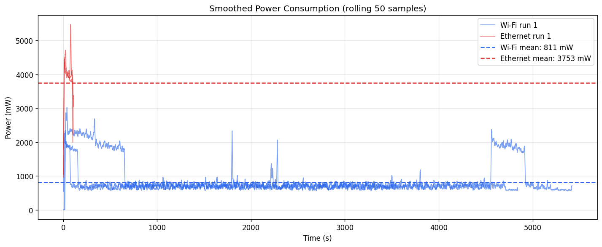

# Characterizing Mobile Security Platforms Using a Low-Cost Pico 2W Power Profiler

Companion repository for the ICEECS-2026 conference paper. Contains the MicroPython firmware, logging server, Jupyter analysis notebook, 3D-printable case, wiring schematic, and raw experimental data.



## What this project does

A Raspberry Pi Pico 2 W paired with a Texas Instruments INA219 current/voltage sensor measures how much power a smartphone draws during security scanning. The instrument sits inline on the phone's USB-C VBUS line, samples voltage and current at 1 Hz, and streams the readings over Wi-Fi to a Python logging server. A small OLED screen on the device shows live graphs of current, voltage, and power; a DHT11 sensor records ambient temperature and humidity alongside each sample.

The instrument was used to profile a Samsung Galaxy A12 running full TCP port scans (`nmap -sT -T4 -p 1-65535`) over Wi-Fi and over USB Ethernet, and then the two transport paths were compared in terms of instantaneous power and total energy per scan.

**Main finding:** Ethernet draws 4.6× more instantaneous power (3753 mW vs 811 mW), but finishes 41.8× faster (~110 s vs ~4600 s). The result is that each Ethernet scan consumes roughly 9× less total energy (413 J vs 3726 J) than the same scan over Wi-Fi.

## Hardware

| Component | Role |
|---|---|
| Raspberry Pi Pico 2 W (RP2350) | Measurement controller, Wi-Fi data transport |
| INA219 breakout (0.1 Ω shunt) | Inline VBUS current and voltage sensing (I2C) |
| SSD1306 0.96″ OLED (128×64) | Live graph and readout display (I2C) |
| DHT11 | Ambient temperature and humidity logging |
| Push button | Cycles OLED display mode |
| USB-C breakout board | Taps into the phone's VBUS line |

Total parts cost: approximately $9–40 USD depending on the region and source.

The wiring diagram is in [`power monitor/electricalScheme.jpg`](powerMonitor/electricalScheme.jpg).

## Repository layout

```
firmware/
  main.py              // MicroPython firmware for the Pico 2 W
logging server/
  server.py             // Python TCP server that writes incoming samples to CSV
analysis/
  power_profiler_analysis.ipynb  // Jupyter/Colab notebook for processing the CSVs
  *.png                 // Pre-rendered plots (overlay, boxplot, ambient, all runs)
tests/
  wifi/                 // 3 Wi-Fi scan runs: CSV data + Nmap result screenshots
  ethernet/             // 3 Ethernet scan runs: CSV data + Nmap result screenshots
case/
  box.stl, lid.stl      // 3D-printable enclosure
power monitor/
  electricalScheme.jpg  // Wiring diagram
```

## Getting started

### 1. Flash the Pico 2 W

Install the [MicroPython UF2 for Pico 2 W](https://micropython.org/download/RPI_PICO2_W/) on the board.

Copy the following libraries to the Pico's filesystem (install via `mip` or copy manually):

- `ina219.py` — [INA219 MicroPython driver](https://github.com/chrisb2/pi_ina219)
- `ssd1306.py` — SSD1306 I2C OLED driver (available via `micropython-ssd1306`)

### 2. Create `config.json`

The firmware loads network settings from a `config.json` file on the Pico. Create it with your own values:

```json
{
  "ssid": "YourNetworkName",
  "password": "YourPassword",
  "laptop_ip": "192.L",
  "port": 5000
}
```

### 3. Start the logging server

On the machine that will collect data:

```bash
python3 "logging server/server.py"
```

Edit the `srv.bind(...)` address in `server.py` to match your machine's local IP. The server listens on port 5000 and writes every received line to `logs.csv`.

### 4. Wire up and power on

Connect the hardware according to the wiring diagram, power on the Pico and then the phone charger. The OLED will show "Connecting..." until it joins the network, then begin displaying live power graphs. Press the button to cycle through current, voltage, power, and text display modes.

### 5. Analyze the data

Open [`analysis/power_profiler_analysis.ipynb`](analysis/power_profiler_analysis.ipynb). The notebook loads the CSVs from `tests/`, computes per-run and per-group statistics, and produces comparison plots.

## CSV format

Each line from the instrument:

```
timestamp_ms,voltage_V,current_mA,power_mW,ambient_temp_C,ambient_humidity_%
```

Timestamps are `time.ticks_ms()` values from the Pico's internal clock (relative, not wall-clock).

## Experimental conditions

- **Device under test:** Samsung Galaxy A12 (SM-A125F), Android, running Termux
- **Scan command:** `nmap -sT -T4 -p 1-65535 <target>`
- **Wi-Fi:** 3 runs, 3551–5422 s each, mean power 811 mW
- **Ethernet:** 3 runs, 105–115 s each, mean power 3753 mW (via USB-C OTG adapter)
- **Ambient:** ~20 °C, 69–71% humidity

## License

This project accompanies an academic paper. If you use the code, data, or design in your own work, please cite the paper.